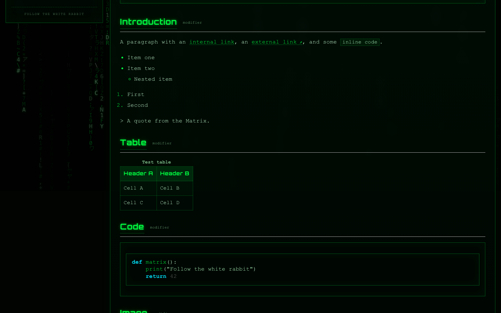
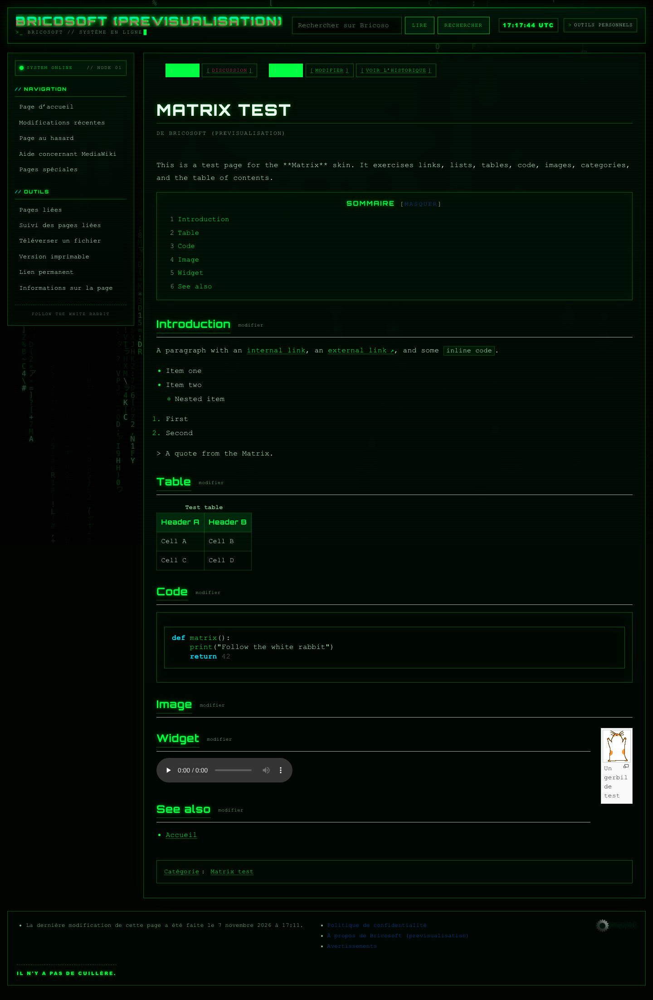
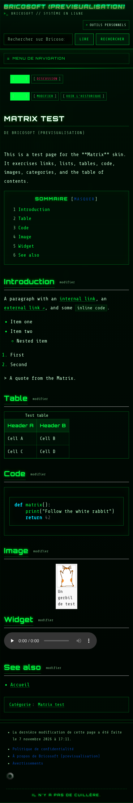
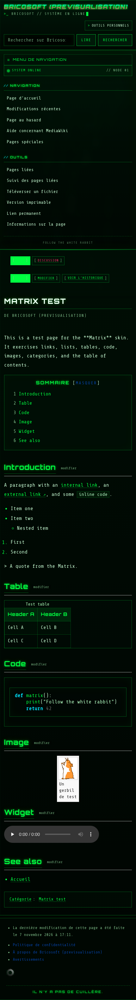
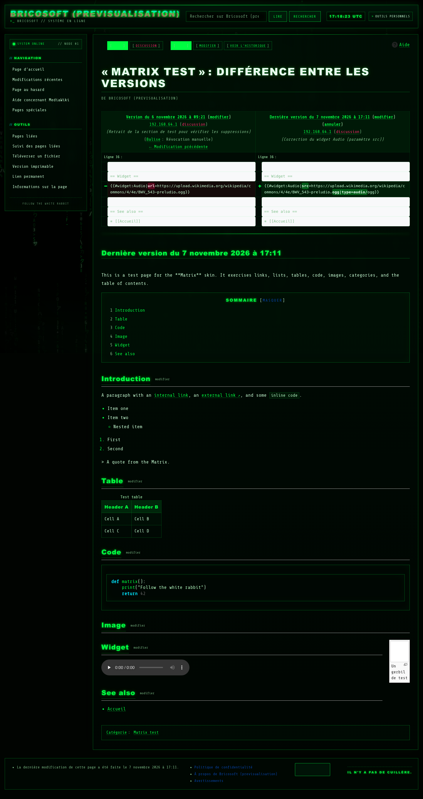
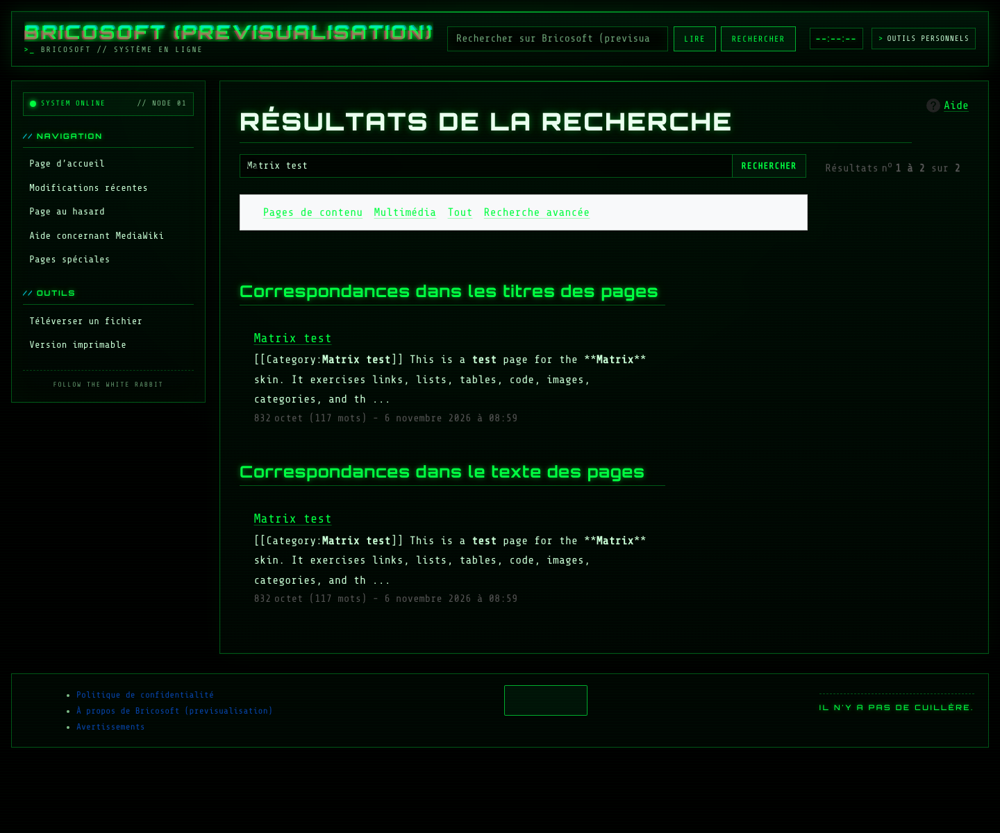

# Matrix

Habillage MediaWiki cyberpunk inspiré de *Matrix* : pluie numérique animée,
néons verts, effet terminal CRT, typographie Orbitron et Share Tech Mono.



## Aperçu

| Bureau | Mobile | Barre latérale mobile |
| --- | --- | --- |
| [](screenshots/desktop.png) | [](screenshots/mobile.png) | [](screenshots/mobile-sidebar.png) |

| Diff | Recherche |
| --- | --- |
| [](screenshots/diff.png) | [](screenshots/search.png) |

Les captures proviennent du miroir local de test, avec une page volontairement
riche : sommaire, tableau, code coloré, image, catégorie, widget audio, diff,
formulaires et pages spéciales.

## Fonctionnalités

- Pluie numérique dessinée sur un canvas fixe, derrière les panneaux de contenu.
- Animation plafonnée à 30 images par seconde, densité de pixels limitée à 2,
  mise en pause quand l'onglet est masqué.
- Respect de `prefers-reduced-motion` : la pluie est totalement désactivée pour
  les personnes qui préfèrent réduire les animations.
- Horloge UTC dans l'en-tête, mise à jour chaque seconde.
- Interface sombre, responsive, avec barre latérale mobile et menus déroulants
  accessibles au clavier (`<details>`).
- Mise en page adaptée aux articles, aux pages spéciales, aux formulaires, aux
  tableaux, aux historiques, aux diffs, à l'édition et à la prévisualisation.
- Polices auto-hébergées en WOFF2 : aucune requête vers un CDN de polices.
- Messages d'interface en anglais et en français, avec documentation `qqq`.
- Favicon Matrix fourni.
- Fonctionnement correct sans JavaScript : le contenu, la navigation, la
  recherche et la barre latérale mobile restent utilisables.

## Compatibilité

- MediaWiki **1.46 ou plus récent** ; testé avec MediaWiki **1.46.2**.
- PHP 8.3 et 8.4 testés.
- Aucune extension obligatoire.
- `Widgets` et `SyntaxHighlight` ont été testés pour les cas de contenu riche,
  mais le skin ne les requiert pas.
- Navigateurs modernes : Chrome, Firefox et Safari récents. Le masquage des
  portlets vides utilise `:has()` avec un repli JavaScript.

## Conventions MediaWiki

Le skin suit le manuel
[« How to make a MediaWiki skin »](https://www.mediawiki.org/wiki/Manual:How_to_make_a_MediaWiki_skin) :

- dossier d'installation nommé `Matrix`, chargé avec `wfLoadSkin( 'Matrix' )` ;
- `skin.json` avec `ValidSkinNames`, `SkinMustache`, `responsive: true` et les
  messages i18n ;
- un seul module de style `SkinModule` (`skins.matrix.styles`) ;
- templates Mustache et partiels dans `templates/`.

Le nom du dépôt GitHub est libre et n'a pas besoin d'être identique au nom du
skin. Les dépôts Wikimedia utilisent souvent `mediawiki-skins-<Nom>` ; ici, le
dépôt s'appelle `mediawiki-skin-matrixfte`, mais il doit être cloné dans
`skins/Matrix` pour que `wfLoadSkin( 'Matrix' )` fonctionne.

## Installation

### 1. Copier le skin

Depuis le dossier `skins/` de votre installation MediaWiki :

```sh
git clone https://github.com/fte/mediawiki-skin-matrixfte.git Matrix
```

Ou copiez simplement le dossier `Matrix` dans `skins/Matrix`.

### 2. Activer le skin

Dans `LocalSettings.php`, ajoutez :

```php
wfLoadSkin( 'Matrix' );
$wgDefaultSkin = 'matrix';
```

Pour tester le skin sans changer le thème par défaut, ajoutez `?useskin=matrix`
à l'URL d'une page.

### 3. Favicon (facultatif)

```php
$wgFavicon = "$wgScriptPath/skins/Matrix/resources/favicon.svg";
```

### 4. Cache

Si les messages du skin n'apparaissent pas immédiatement :

```sh
php maintenance/run.php rebuildLocalisationCache
```

## Personnalisation

### Messages

Les textes principaux sont des messages MediaWiki, modifiables depuis le wiki :

- `MediaWiki:Matrix-tagline` : slogan affiché sous le titre du site.
- `MediaWiki:Matrix-footer-quote` : citation du pied de page.

Les valeurs par défaut se trouvent dans `i18n/en.json` et `i18n/fr.json`.

### Couleurs et typographie

Les variables CSS sont regroupées au début de
`resources/skins.matrix.css` :

```css
:root {
	--mx-bg: #010401;
	--mx-green: #00ff41;
	--mx-cyan: #00e5ff;
	--mx-magenta: #ff2a6d;
	--mx-amber: #ffb400;
	--mx-text: #c9ffd6;
	--mx-font: 'Share Tech Mono', 'Courier New', Courier, monospace;
	--mx-display: 'Orbitron', 'Arial Black', 'Helvetica Neue', sans-serif;
}
```

Modifiez ces variables pour adapter le skin à votre charte graphique.

### Pluie numérique

Les réglages principaux sont dans `resources/skins.matrix.js` :

- `fontSize` : taille des glyphes, réduite automatiquement sur mobile ;
- `frameInterval` : limite de fréquence (30 fps par défaut) ;
- `getDpr()` : plafond de densité de pixels ;
- `chars` : jeu de caractères utilisé par la pluie.

## Structure

```text
Matrix/
├── i18n/                  Messages en, fr et qqq
├── resources/
│   ├── fonts/             WOFF2 et licences OFL
│   ├── favicon.svg
│   ├── fonts.css
│   ├── skins.matrix.css
│   └── skins.matrix.js
├── screenshots/           Captures de démonstration
├── templates/             Templates Mustache
├── CHANGELOG.md
├── LICENSE
├── README.md
└── skin.json
```

## Tests effectués

Le skin a été validé sur un miroir MediaWiki 1.46.2 avec les cas suivants :

- article riche : sommaire, liens, listes, tableau, code, image, catégories ;
- widget audio HTML5 ;
- pages spéciales : version, recherche, connexion, préférences,
  modifications récentes, téléversement ;
- édition, prévisualisation, historique et diff ;
- affichage bureau et mobile, y compris les formulaires et les tableaux ;
- absence de débordement horizontal sur les pages testées ;
- fonctionnement avec JavaScript désactivé ;
- mode `prefers-reduced-motion`.

## Polices

- **Orbitron** — SIL Open Font License 1.1.
  Voir `resources/fonts/OFL-Orbitron.txt`.
- **Share Tech Mono** — SIL Open Font License 1.1.
  Voir `resources/fonts/OFL-ShareTechMono.txt`.

Les fichiers WOFF2 sont redistribués avec leurs licences.

## Licence

Le skin Matrix est distribué sous **GPL-2.0-or-later**.
Voir le fichier [LICENSE](LICENSE).

Les polices restent sous SIL Open Font License 1.1, comme indiqué ci-dessus.

## Crédits

- Développé pour [Bricosoft](https://www.bricosoft.com).
- Construit avec [MediaWiki](https://www.mediawiki.org/) et `SkinMustache`.
- Inspiré de l'esthétique de *Matrix*.
